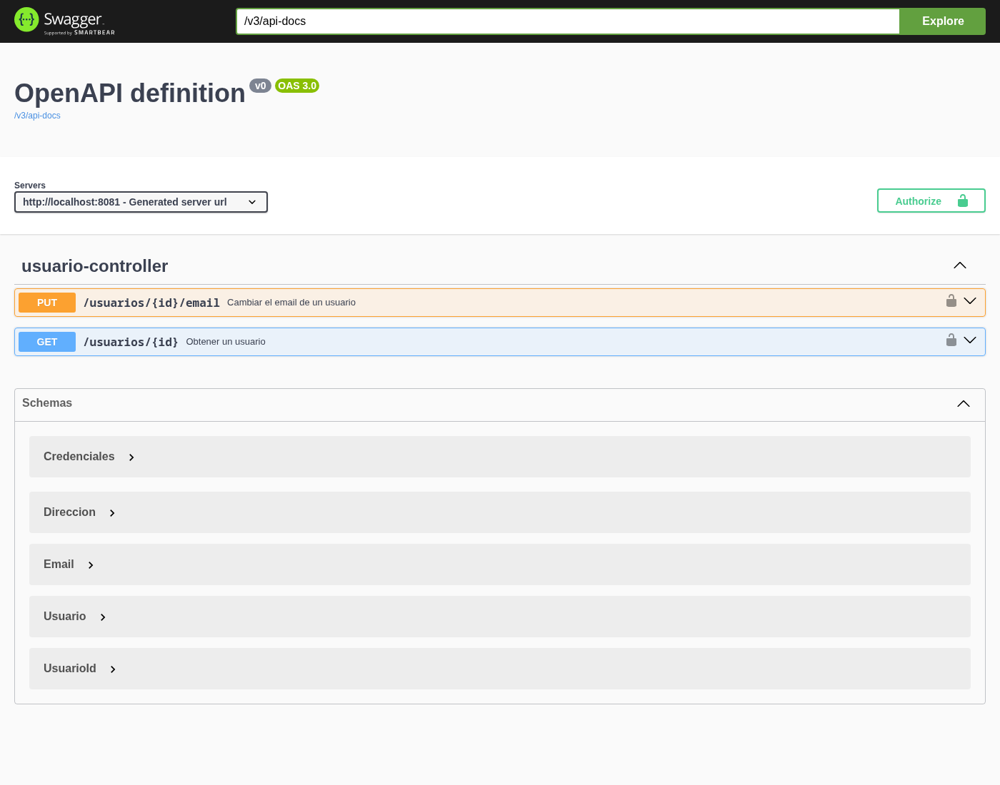
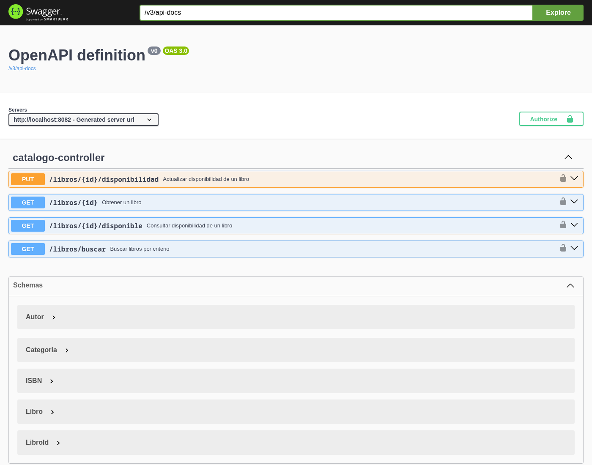
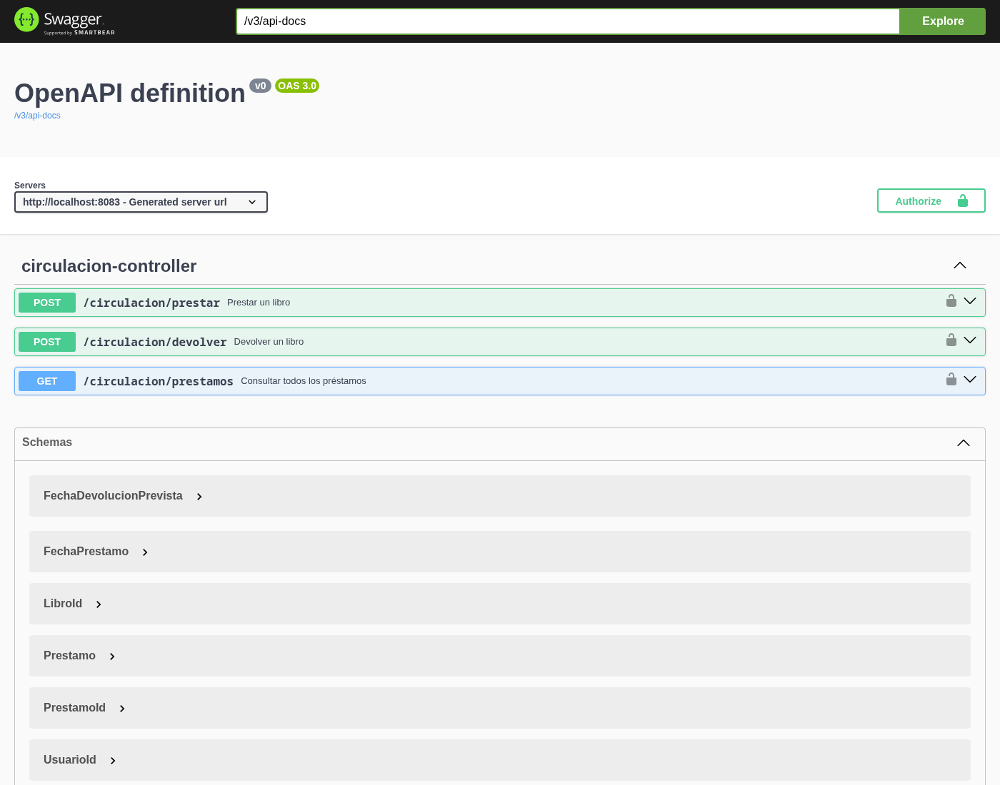
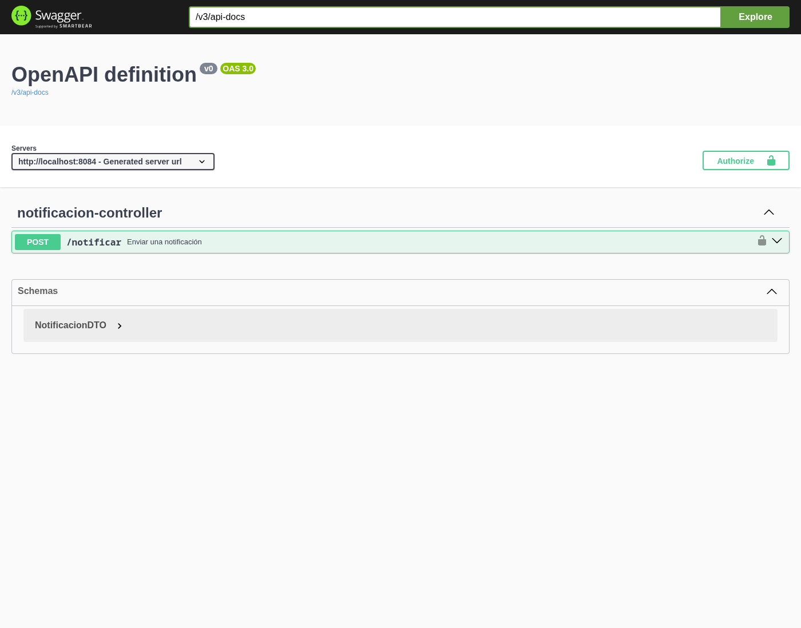

# Sistema de Gestión de Biblioteca - Microservicios
Sistema de biblioteca basado en microservicios Spring Boot con autenticación y autorización mediante **Keycloak + JWT (OIDC)**.

## Arquitectura

| Servicio | Puerto | Descripcion |
|---|---|---|
| `microservicio-usuarios` | 8081 | Gestion de usuarios |
| `microservicio-catalogo` | 8082 | Catalogo de libros y disponibilidad |
| `microservicio-circulacion` | 8083 | Prestamos y devoluciones |
| `microservicio-notificacion` | 8084 | Notificaciones a usuarios |
| `keycloak` | 8080 | Proveedor de identidad (realm `biblioteca`) |

```
[Cliente] ── Bearer JWT ──> [usuarios:8081] [catalogo:8082] [circulacion:8083] [notificacion:8084]
                                   ▲
              circulacion se comunica con catalogo y notificacion via OpenFeign
              (token client_credentials de su service account)
                                   ▲
                 [keycloak:8080] emite y valida los tokens (JWKS)
```

Los servicios corren en red `host` (dev/local, Linux). Cada microservicio es un **resource server**: valida la firma del JWT contra las claves publicas de Keycloak sin estado compartido.

## Como levantar el proyecto

```bash
docker compose up --build
```

Keycloak importa automaticamente el realm desde `keycloak/realm-biblioteca.json` al arrancar.

## Configuracion de Keycloak

Realm: **biblioteca** (importado al inicio, reproducible).

### Roles
| Rol | Permisos |
|---|---|
| `ADMIN` | Todo: ver prestamos, gestionar usuarios, cambiar disponibilidad |
| `BIBLIOTECARIO` | Prestar/devolver libros, cambiar disponibilidad |
| `LECTOR` | Buscar y consultar libros |

### Clientes
| Client | Tipo | Uso |
|---|---|---|
| `biblioteca-app` | public | Frontend / pruebas. Login con password grant |
| `catalogo`, `circulacion`, `notificacion`, `usuarios` | confidential | Un client por microservicio (secret + service account) |

### Usuarios de prueba (password: `1234`)
| Usuario | Rol |
|---|---|
| `admin` | ADMIN |
| `ana` | BIBLIOTECARIO |
| `lucas` | LECTOR |

### Obtener un token

```bash
curl -X POST http://localhost:8080/realms/biblioteca/protocol/openid-connect/token \
  -d grant_type=password -d client_id=biblioteca-app \
  -d username=ana -d password=1234
```

## Seguridad (JWT)

- Los microservicios validan el JWT con `spring-boot-starter-oauth2-resource-server`.
- Los roles viajan en el claim `realm_access.roles` del token y se mapean a `ROLE_*`.
- Autorizacion por rol con `@PreAuthorize` en los controllers:

| Endpoint | Roles permitidos |
|---|---|
| `GET /libros/*`, `GET /usuarios/{id}` | cualquier autenticado |
| `PUT /libros/{id}/disponibilidad` | ADMIN, BIBLIOTECARIO |
| `POST /circulacion/prestar`, `/devolver` | ADMIN, BIBLIOTECARIO |
| `GET /circulacion/prestamos` | ADMIN |
| `PUT /usuarios/{id}/email` | ADMIN |
| `POST /notificar` | cualquier autenticado |

- La comunicacion entre circulacion y catalogo/notificacion usa OpenFeign con un token `client_credentials` inyectado por `RequestInterceptor`.

## Pruebas

Coleccion de Postman en `postman/biblioteca-seguridad.postman_collection.json` con casos:

| Caso | Resultado |
|---|---|
| Sin token | 401 |
| Token invalido | 401 |
| Token valido | 200 |
| Token valido con rol insuficiente | 403 |

## Documentacion Swagger (Swagger UI)

Cada servicio expone Swagger UI con el esquema OAuth2 para autenticarse contra Keycloak.

### Usuarios - `http://localhost:8081/swagger-ui/index.html`


### Catalogo - `http://localhost:8082/swagger-ui/index.html`


### Circulacion - `http://localhost:8083/swagger-ui/index.html`


### Notificacion - `http://localhost:8084/swagger-ui/index.html`
